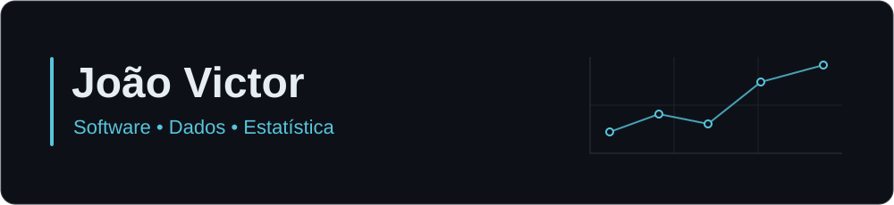

  

# João Victor

Desenvolvedor de software com foco em dados e análise. Graduando em Estatística na UFPB.

[Portfólio](https://jonhvito.com.br) · [LinkedIn](https://www.linkedin.com/in/jonhvito/) · [GitHub](https://github.com/jonhvito)

## Sobre

Combino desenvolvimento de software e Estatística para trabalhar com dados, regras de negócio e problemas operacionais. Meus projetos incluem aplicações web, ferramentas de análise e interfaces para estudar conceitos estatísticos.

Curso Bacharelado em Estatística na **UFPB** e concluí o Técnico em Informática na **UNICORP** em 2026. Tenho experiência com desenvolvimento, suporte técnico, infraestrutura e bancos de dados. Atualmente, atuo como estagiário de graduação em Estatística na área de dados, com consultas, automações, análises e acompanhamento de indicadores.

Tenho interesse em otimização combinatória, pesquisa operacional e teoria dos grafos, além de engenharia de dados e desenvolvimento web.

## Tecnologias

<!-- Ícones Devicon fixados em v2.17.0. Os nomes permanecem legíveis sem as imagens. -->

**Dados e análise** · Python, pandas e Streamlit

  
  &nbsp;
  
  &nbsp;
  

**Interfaces web** · JavaScript, TypeScript, React e Tailwind CSS

  
  &nbsp;
  
  &nbsp;
  
  &nbsp;
  

**Backend** · Django e Flask. **Estudos em dados e Estatística** · SQL e R.

## Projetos em destaque

| Projeto | Implementação | Tecnologias principais | Links |
| :--- | :--- | :--- | :--- |
| **Python, de cabeça** | Aplicação de estudo com 136 atividades, revisão espaçada e execução de Python no navegador. | JavaScript, HTML, CSS, Pyodide | [Código](https://github.com/jonhvito/pratica-python-basico) · [Aplicação](https://jonhvito.github.io/pratica-python-basico/) |
| **ChurnLens** | Análise de clientes do conjunto público Olist com métricas RFM, segmentação por regras, dashboard e API REST. | Python, Flask, pandas, Chart.js | [Código](https://github.com/jonhvito/ChurnLens) |
| **Horários UFPB** | Organização de disciplinas, identificação de conflitos e exportação da grade de horários. | React, TypeScript, Tailwind CSS, Zustand | [Código](https://github.com/jonhvito/horario) · [Aplicação](https://jonhvito2.github.io/horario_DEV/) |
| **Dashboard de Usinas de Energia** | Exploração de dados ANEEL/SIGA com filtros, mapas e análise espacial por Moran e LISA. | Python, Streamlit, pandas, GeoPandas, PySAL | [Código](https://github.com/jonhvito/projeto_streamlit) · [Aplicação](https://jonhvito-projeto-streamlit-main-udv4s8.streamlit.app/) |
| **Calculadora Binomial** | Cálculo de probabilidades binomiais, comparação com aproximações e visualização das distribuições. | React, TypeScript, Chart.js, Tailwind CSS | [Código](https://github.com/jonhvito/Binomial) · [Aplicação](https://jonhvito.github.io/Binomial/) |

## Estatísticas do GitHub

  
Ver contribuições e linguagens dos repositórios

   

  <!--
    Tema dos cards (cores hexadecimais sem # nas URLs):
    fundo: 0D1117 | destaque: 58C4DC | texto: E6EDF3
    Stats/Top Languages: bg_color, title_color, text_color, icon_color.
    Streak: background, ring, fire, currStreakLabel, sideLabels,
    dates, currStreakNum e sideNums.
    Para mudar a paleta, substitua esses três códigos nas URLs e no banner.
  -->

  

    
    
  

  

    
  

  
As linguagens refletem o código dos repositórios públicos, não o nível de domínio de cada tecnologia.

## Atividade

<picture>
  <source media="(prefers-color-scheme: dark)" srcset="https://raw.githubusercontent.com/jonhvito/jonhvito/output/github-snake-dark.svg" />
  <source media="(prefers-color-scheme: light)" srcset="https://raw.githubusercontent.com/jonhvito/jonhvito/output/github-snake.svg" />
  
</picture>

## Contato

[Portfólio](https://jonhvito.com.br) · [LinkedIn](https://www.linkedin.com/in/jonhvito/) · [GitHub](https://github.com/jonhvito)

---

João Victor · João Pessoa, Paraíba, Brasil

